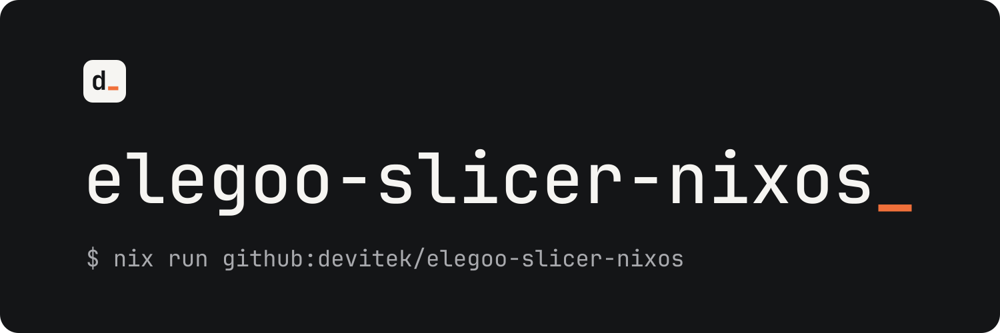

<p align="center">
  
</p>

<p align="center">ElegooSlicer for NixOS, kept in sync with upstream releases.</p>

<p align="center">
  <a href="https://github.com/Devitek/elegoo-slicer-nixos/releases/latest"></a>
  <a href="https://github.com/Devitek/elegoo-slicer-nixos/actions/workflows/ci.yml"></a>
  <a href="https://github.com/elegooofficial/ElegooSlicer/releases"></a>
  <a href="LICENSE"></a>
</p>

<p align="center">
  <a href="#installation">Installation</a> ·
  <a href="#usage">Usage</a> ·
  <a href="#documentation">Documentation</a> ·
  <a href="CHANGELOG.md">Changelog</a> ·
  <a href="CONTRIBUTING.md">Contributing</a>
</p>

[ElegooSlicer](https://github.com/elegooofficial/ElegooSlicer) is Elegoo's open-source FDM slicer, an OrcaSlicer fork. This repository repackages its official Linux AppImage for NixOS, with a desktop entry, file associations and declarative install. New upstream releases are picked up, built, smoke-tested and merged automatically.

> [!NOTE]
> Community project, not affiliated with or endorsed by Elegoo. Slicer bugs belong [upstream](https://github.com/elegooofficial/ElegooSlicer/issues); packaging bugs belong [here](https://github.com/Devitek/elegoo-slicer-nixos/issues).

## Installation

Try it without installing anything:

```sh
nix run github:devitek/elegoo-slicer-nixos
```

Or add the flake to your inputs:

```nix
{
  inputs.elegoo-slicer.url = "github:devitek/elegoo-slicer-nixos";
  inputs.elegoo-slicer.inputs.nixpkgs.follows = "nixpkgs"; # optional
}
```

Supports `x86_64-linux`, the only Linux build upstream publishes. The 3D preview needs OpenGL, so enable `hardware.graphics.enable = true;` on NixOS.

## Usage

**NixOS**

```nix
{
  imports = [ elegoo-slicer.nixosModules.default ];
  programs.elegoo-slicer.enable = true;
}
```

**Home Manager**

```nix
{
  imports = [ elegoo-slicer.homeManagerModules.default ];
  programs.elegoo-slicer.enable = true;
}
```

**Overlay**

```nix
nixpkgs.overlays = [ elegoo-slicer.overlays.default ];
# then: pkgs.elegoo-slicer
```

## How updates work

[nvfetcher](https://github.com/berberman/nvfetcher) tracks upstream releases. When a new one lands, the update workflow refreshes the version and hash, runs `nix flake check` (build, smoke test, module evaluation) and merges the change. [release-please](https://github.com/googleapis/release-please) then cuts a SemVer release of this repository. Pin a tag if you prefer to update on your own schedule.

<details>
<summary><strong>Troubleshooting</strong></summary>

**`HTTP error 403` when fetching the flake.** Fetch over git instead of the GitHub API:

```sh
nix run 'git+https://github.com/devitek/elegoo-slicer-nixos'
```

</details>

## Documentation

- [Functional overview](docs/functional.md)
- [Technical architecture](docs/technical.md)
- [Architecture Decision Records](docs/adr/)

## Contributing

Contributions are welcome. Please read [CONTRIBUTING.md](CONTRIBUTING.md) first: one issue per change, Conventional Commits, green CI.

## License

The packaging code is released under the [MIT License](LICENSE). ElegooSlicer itself remains under its upstream license (AGPL-3.0).

---

<p align="center">
  <a href="https://github.com/Devitek">
    <picture>
      <source media="(prefers-color-scheme: dark)" srcset=".github/assets/devitek-wordmark-blanc.svg">
      
    </picture>
  </a>
  <br>
  <sub>Built and maintained by <a href="https://github.com/Devitek">Devitek</a></sub>
</p>
